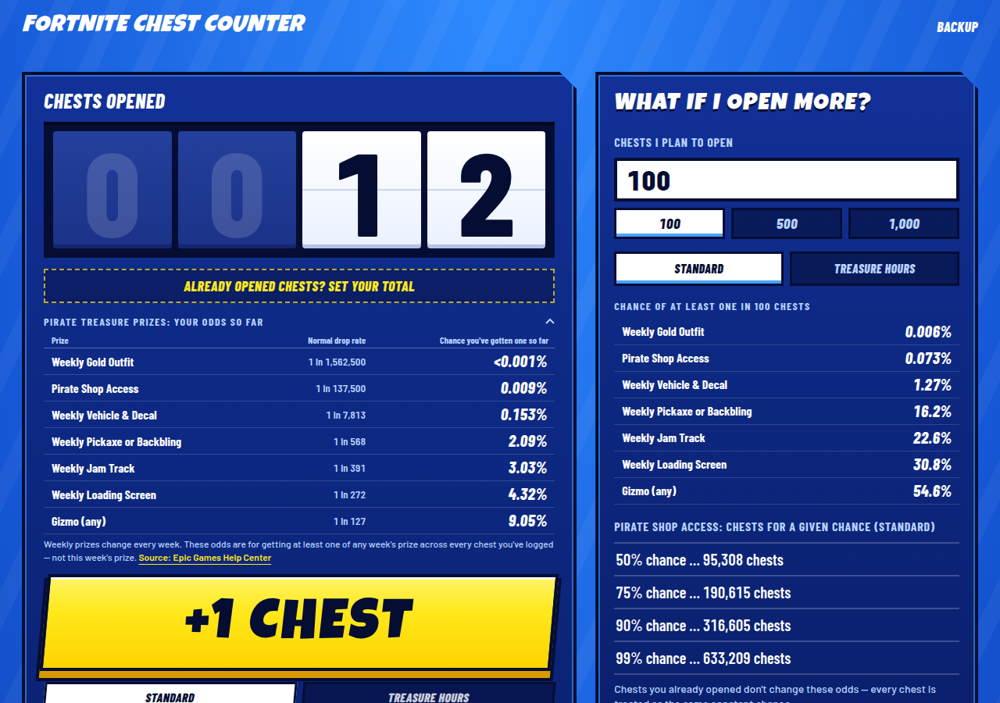
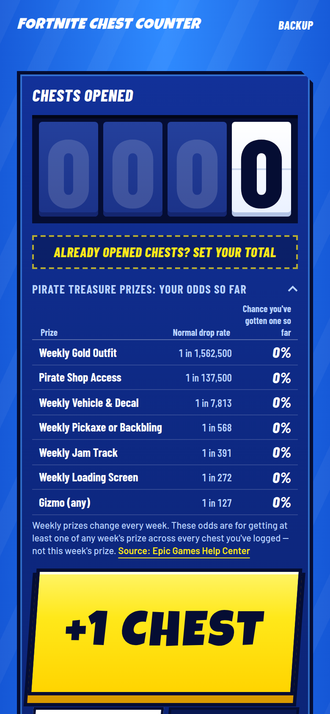

# Fortnite Chest Counter & Pirate Shop Access Odds Calculator

A free, fan-made **Fortnite chest counter**: tap **+1 Chest** every time you open a Pirate Treasure chest, and see your chance of having found each prize, including **Pirate Shop Access**. It also has a Pirate Shop Access **odds calculator** that answers "how many chests until I have a 50% / 90% chance?".

**Live site: <https://chestcounterfn.com>**

No account, no ads, no tracking. Your counts are stored in your own browser (`localStorage`).





## Features

- **Chest counter**: big +1 button, undo, add a batch of 1–999 chests, and "Set total" if you already opened chests before you found the tool.
- **Treasure Hours mode**: log chests with the boosted rates; the boost values are editable because Epic says they may change.
- **Odds for all seven Pirate Treasure prizes**: Weekly Gold Outfit, Pirate Shop Access, Weekly Vehicle & Decal, Weekly Pickaxe or Back Bling, Weekly Jam Track, Weekly Loading Screen and Gizmo.
- **Pirate Shop Access odds calculator**: enter how many chests you plan to open and get the chance of at least one; see how many chests give a 50%, 75%, 90% or 99% chance.
- **Your data stays yours**: export and import a JSON backup, reset everything, multi-tab sync, and a clear warning if the browser can't save.
- **Static site**: Vite + React + TypeScript, no server or database.

## How the odds are calculated

The drop rates come from Epic Games' help article
[What are the drop rates of treasure in chests in Fortnite Battle Royale's Pirate Treasure event?](https://www.epicgames.com/help/fortnite-battle-royale-c-34254770/gameplay-c-33726977/what-are-the-drop-rates-of-treasure-in-chests-in-fortnite-battle-royale-s-pirate-treasure-event-a14361627)
For example, **Pirate Shop Access is 1 in 137,500 per chest**, and Epic lists a 1.5× rate for it during Treasure Hours.

The chance of getting a prize at least once in `n` chests, with a per-chest rate `p`, is:

```
chance = 1 − (1 − p)^n
```

Every chest is treated as an independent roll at a constant rate, so the result is an estimate of your chances. It is not a countdown to a drop, and chests you already opened don't make the next one more likely.

## Run it locally

Requires Node.js 22+ and [pnpm](https://pnpm.io/).

```bash
pnpm install
pnpm dev        # development server
pnpm build      # static site in dist/
pnpm preview    # serve dist/ locally
pnpm test       # unit tests (Vitest)
pnpm lint
pnpm typecheck
```

`dist/` is plain static files and can be hosted anywhere (GitHub Pages, Cloudflare Pages, Netlify, any web server).

## Project layout

- `src/odds.ts`: the probability formulas.
- `src/tally/`: the counting domain (model, storage, backup codec), independent of React.
- `src/*.tsx`: the counter, calculator, prize table and dialogs.
- `tests/`: Vitest tests for the odds and the tally modules.

## Fonts

Self-hosted through [Fontsource](https://fontsource.org/), no CDN requests:
Barlow and Barlow Condensed (SIL Open Font License 1.1) and Luckiest Guy (Apache License 2.0). See [NOTICE.md](NOTICE.md).

## Disclaimer

Fan-made. Not affiliated with or endorsed by Epic Games. Fortnite is a trademark of Epic Games, Inc. This project uses no Epic or Fortnite logos or game assets. Drop rates are quoted from Epic's public help article and may change; check it for the latest numbers.

## License

[MIT](LICENSE). Bundled fonts keep their own licenses, see [NOTICE.md](NOTICE.md).
